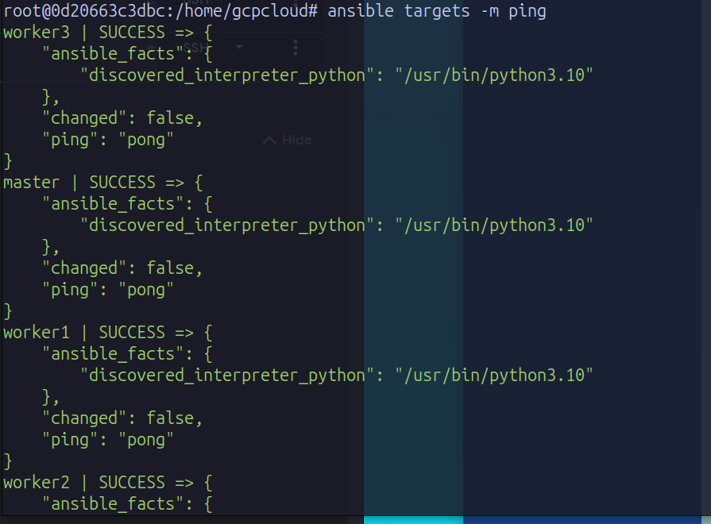
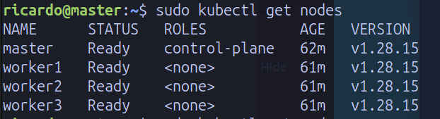
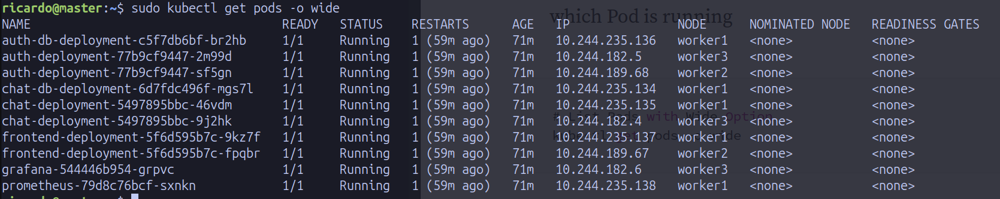
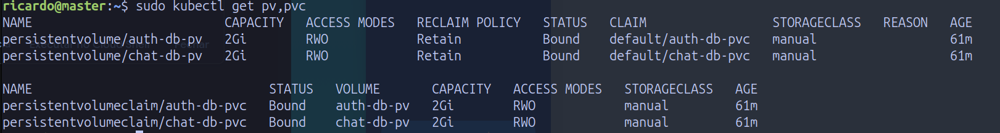
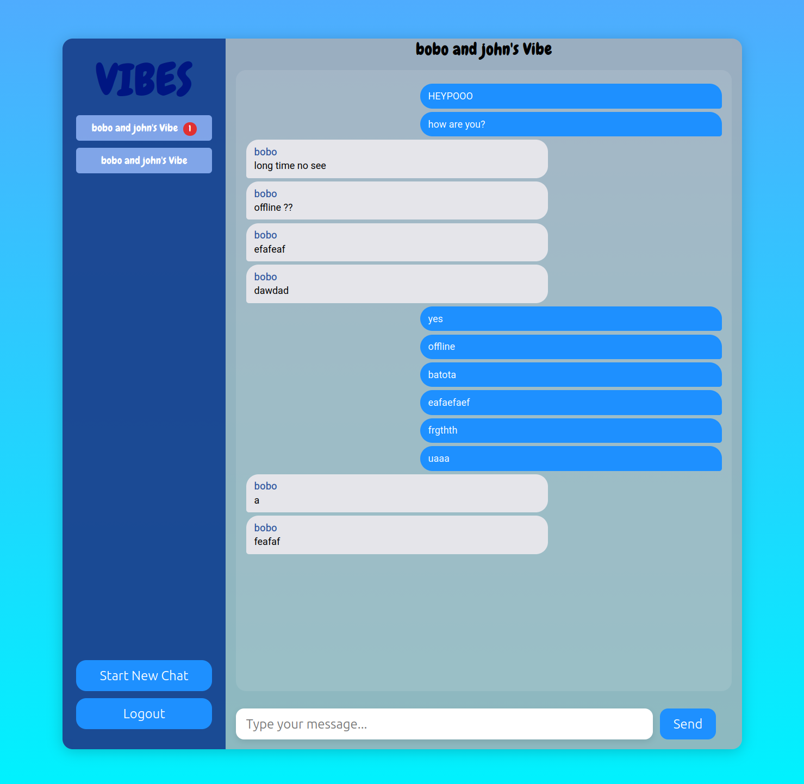
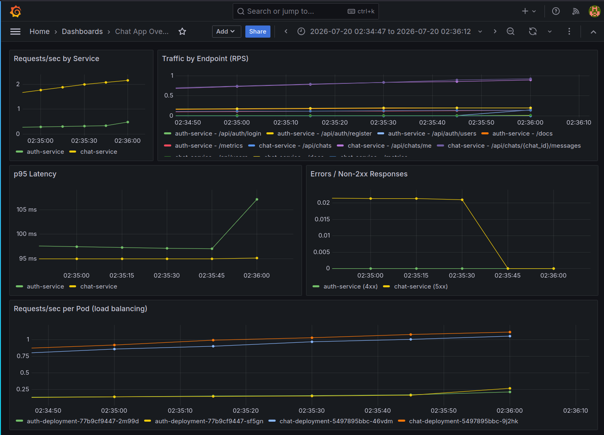

# Vibes - Instant Messaging on Self-Hosted Kubernetes

A microservices-based chat application (register,
login, direct messages, group chats, offline message delivery) deployed on a
**self-hosted Kubernetes cluster on Google Cloud**, provisioned and operated
entirely with Infrastructure-as-Code (Terraform + Ansible), monitored with
Prometheus + Grafana, and implementing **persistent state** as the advanced
feature.

## Architecture

```
                        browser
                           │  http://<any-node-ip>:30080
                           ▼
              ┌─ NodePort 30080 (every node) ─┐
              │        frontend (nginx)        │  2 replicas - serves the React
              │  /api/auth/* ──► auth-service  │  app and reverse-proxies the API
              │  /api/*      ──► chat-service  │
              └───────┬──────────────┬─────────┘
                      ▼              ▼
               auth-service    chat-service      2 replicas each (FastAPI),
                      │              │           expose /metrics
                      ▼              ▼
                  auth-db        chat-db         postgres:15, one instance PER
                      └──────┬───────┘           service, PersistentVolumes on
                             ▼                   worker1 (state survives full
                   /mnt/data/* (worker1 disk)    infrastructure shutdown)

   monitoring: prometheus (:30900) scrapes annotated pods · grafana (:30300)
   cluster: 1 master + 3 workers (GCP VMs, kubeadm 1.28, Calico)
```

Key design decisions:
- **NodePort ingress** - since a self-hosted cluster has no cloud load-balancer controller, the frontend is exposed on port 30080 of every node.
- **Service-owned data** - each backend service owns its database. The
  chat-service never queries auth-db; it gets user data only through the
  auth-service API (`GET /api/auth/users`), so auth-service stays the single
  place that controls access to user records.
- **Persistent state** - database data lives on hostPath PersistentVolumes
  pinned to worker1; it survives pod restarts, redeploys and full VM
  stop/start cycles.

## Repository layout

| Path | Contents |
|---|---|
| `services/auth-service/` | FastAPI: registration, login, JWTs, user directory |
| `services/chat-service/` | FastAPI: chats, group chats, messages, offline queue |
| `frontend/vibes-frontend/` | React UI + nginx (also the API gateway) |
| `database/` | `auth-init.sql`, `chat-init.sql` - both database schemas |
| `docker-compose.yml` | local deployment + the `mgmt` management container |
| `Dockerfile` | `mgmt` image: terraform + ansible + gcloud |
| `gcpcloud/` | all cloud IaC: terraform (VMs, firewall), cluster playbooks, `deployment.yaml`, `monitoring.yaml` |
| `scripts/push-images.sh` | builds and pushes the app images to Docker Hub |

## Running locally (docker-compose)

Prerequisites: Docker + docker-compose.

1. Create the env files from their templates:
   - `services/auth-service/.env` and `services/chat-service/.env` from the
     `.env.template` in each folder (`JWT_SECRET`, `DATABASE_URL`,
     chat additionally `AUTH_SERVICE_URL=http://auth-service:8000`)
   - `database/.env` (`POSTGRES_USER`, `POSTGRES_PASSWORD`, `POSTGRES_DB`)
2. `docker compose up -d --build`
3. Open `http://localhost:8080` - register two users (two browsers) and chat.

**Tip**: Use Incognito Mode because the auth token is stored in the browser and may render you unable to have 2 open windows with different users.

## Deploying to the cloud (full system)

### 0. One-time preparation (on your host)

```bash
# Build and push the app images to your Docker Hub account
docker login
./scripts/push-images.sh <your-dockerhub-username>

# Deployment variables (secrets; the file stays local, never committed)
cp gcpcloud/deployment-vars.example.yml gcpcloud/deployment-vars.yml
# edit it: docker_user, postgres_password, jwt_secret, grafana_admin_password
```

Place your GCP **service-account key** (JSON, from GCP Console -> IAM ->
Service Accounts -> Manage keys) inside `gcpcloud/`, then fill in the
placeholders: `<PROJECT_ID>` in `terraform-gcp-variables.tf`, and
`<PATH_TO_CREDENTIALS_JSON>` (e.g. `./my-key.json`) in
`terraform-gcp-provider.tf` and `ansible-load-credentials.sh`. Enable the
Compute Engine API for your GCP project in API & Services -> Compute Engine.

### 1. Management node

```bash
docker compose up -d --build mgmt
just mgmt          # all following commands run inside mgmt
gcloud auth login  # once per container
cd /home/gcpcloud && ./ansible-load-credentials.sh
```

### 2. Provision the VMs (Terraform)

```bash
cd /home/gcpcloud
terraform init
terraform apply                  # creates master + 3 workers + firewall
```

Copy the output IPs into `gcphosts` (the `ansible_host=` fields for `master`
and `worker1/2/3`), then verify:

```bash
ansible targets -m ping          # all 4 must answer "pong"
```



### 3. Build the Kubernetes cluster (Ansible)

```bash
ansible-playbook ansible-gcp-configure-nodes.yml
ansible-playbook ansible-k8s-install.yml
ansible-playbook ansible-create-cluster.yml
ansible-playbook ansible-workers-join.yml
```

### 4. Deploy the application + monitoring

```bash
ansible-playbook ansible-start-deployment.yml
```

Renders `deployment.yaml` (databases with persistent volumes, auth, chat,
frontend) and `monitoring.yaml` (Prometheus + Grafana with the dashboard) from
your `deployment-vars.yml`, and applies them on the master. First run pulls
images - allow a few minutes.

### 5. Verify and use

SSH into master node using `gcloud compute ssh --zone "<YOUR-ZONE>" "master" --project "<YOUR-PROJECT>"`.<br>
Run `sudo kubectl get nodes` (should output 4 Ready).<br>
Run `sudo kubectl get pods -o wide` (should show all pods Running).<br>
Run `sudo kubectl get pv,pvc` (should display all PersistentVolumes and PersistentVolumeClaims Bound).<br>

All expected outputs are represented in the images below:<br>





Then, using any node's public IP:

| URL | Service |
|---|---|
| `http://<any-node-ip>:30080` | the chat application |
| `http://<any-node-ip>:30300` | Grafana (`admin` / your password) |


Conversations support direct and group chats; messages sent while a user is
offline are held and flagged as unread when they return (notification badge
on the chat list):



### 6. Tear down

On *mgmt*:

```bash
ansible-playbook ansible-delete-deployment.yml   # optional
terraform destroy                                # deletes VMs AND disks
```

## Persistent state (advanced feature)

Database data lives on worker1's disk. To demonstrate, run on *mgmt*:

```
gcloud compute instances stop  master worker1 worker2 worker3 --zone <YOUR-ZONE>
gcloud compute instances start master worker1 worker2 worker3 --zone <YOUR-ZONE>
```

The whole infrastructure powers off; after restart the cluster reassembles
and all users, chats and messages are intact. <br>
(Public IPs rotate on restart - use `gcloud compute instances list` to get the new values for **gcphosts**.) Only
`terraform destroy` deletes the data, because it deletes the disks.

How the data is kept safe:
- each database stores its files under `/mnt/data/<db>` on worker1, exposed as
  a PersistentVolume with reclaim policy `Retain`, so Kubernetes never deletes
  them automatically;
- each database pod is pinned to worker1 (`nodeSelector`), next to its files;
- each database runs as a single replica with the `Recreate` strategy, so
  the old pod stops before the new one starts and two postgres processes
  never write the same directory at once;
- postgres runs the init SQL only against an empty data directory, so
  redeploying the application never wipes existing data.

**Limitation:** the databases are persistent but not highly available. Each
runs as a single instance on worker1; if worker1 fails, the data survives but
the application cannot reach it until the node returns. The natural extension
is PostgreSQL streaming replication with a standby on another worker.

## Monitoring

Both FastAPI services expose Prometheus metrics at `/metrics`
(request counts, latency histograms, status codes). Prometheus discovers any
pod annotated `prometheus.io/scrape: "true"`. Grafana boots fully provisioned - datasource and the "Chat App Overview" dashboard (traffic per endpoint,
requests/s per service and per pod, p95 latency, error rate) are ConfigMaps,
so no manual setup is needed.<br>



## Performance

Measured with ApacheBench from a machine outside GCP, 1000 requests per
concurrency level C, against the API path `/api/users`, which exercises the
full backend chain (nginx -> chat-service -> auth-service -> auth-db):

```bash
ab -n 1000 -c C http://<node-ip>:30080/api/users    # C in 1, 5, 10, 25, 50
```

| concurrent clients | requests/s | p50 | p95 | p99 |
|---|---|---|---|---|
| 1 | 7.8 | 124 ms | 144 ms | 232 ms |
| 5 | 34.3 | 137 ms | 181 ms | 316 ms |
| 10 | 56.0 | 173 ms | 243 ms | 379 ms |
| 25 | 77.5 | 301 ms | 522 ms | 707 ms |
| 50 | 83.7 | 630 ms | 967 ms | 1028 ms |

- **Baseline latency** - the ~124 ms at a single client is mostly network
  round-trip to the cluster's region (europe-west3), not server processing.
- **Saturation** - throughput climbs quickly up to ~10 clients, then
  flattens at ~84 req/s: going from 25 to 50 clients adds only 8% throughput
  while p95 latency nearly doubles (522 ms -> 967 ms). Past capacity, extra
  requests just queue longer.
- **Locating the bottleneck** - the same test against the static path
  (`http://<node-ip>:30080`, answered by nginx alone) reaches 449 req/s with a
  p95 of 120 ms at 50 clients: ~5x the throughput and ~8x lower tail latency.
  So the cluster, network and NodePort routing are not the limit; the cost is
  the per-request work across two Python services (including the
  chat-service -> auth-service call that keeps their databases separate) and
  a database query.
- No request failed in any run, and the per-pod Grafana panel showed load
  split evenly across the two replicas of each service.

These numbers reflect small e2-medium VMs. A natural next step is to raise
the replica count (one value per Deployment in `deployment.yaml`) and check
whether throughput scales with it.

## Team

Ricardo Horta
